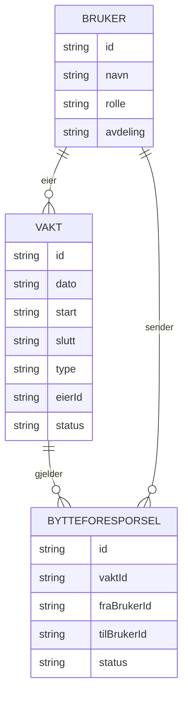

# Vaktbytte

En webapp som gjør det enkelt for helsepersonell å bytte vakter og ha oversikt over sine egne vakter med ulike funksjonar. 

## Hvorfor?
Jeg har jobbet som i helsevesenet i over 10 år, og vaktbytter skjer ofte via SMS, via leder,
Facebook-grupper og man har ikke oversikt på hvordan dette påvirker lønningen. Det er rotete, og det er lett
å miste oversikten. Denne appen samler alt på ett sted.

## Planlagte funksjoner (MVP)
- [ ] Se egne vakter
- [ ] Legge ut en vakt man vil bytte bort
- [ ] Se ledige vakter og be om å ta en
- [ ] Leder godkjenner eller avslår bytter

## Teknologi
- HTML, CSS, JavaScript

## Status
🚧 Under planlegging

##Wireframes:
Mobilversjon: Enkelt, kort med store knapper. 

##Wireframes: Mobilversjon: Enkelt, kort med store knapper. ┌─────────────────────────┐ │ ☰ Mine vakter │ ├─────────────────────────┤ │ NOVEMBER │ │ ┌─────────────────────┐ │ │ │ Lør 14. nov │ │ │ │ Kveld 15:00–22:30 │ │ │ │ Avd. Medisin │ │ │ │ [Legg ut] │ │ │ └─────────────────────┘ │ │ ┌─────────────────────┐ │ │ │ Tir 17. nov │ │ │ │ Dag 07:30–15:00 │ │ │ │ Avd. Medisin │ │ │ │ [Legg ut] │ │ │ └─────────────────────┘ │ │ │ ├─────────────────────────┤ │ 🏠 🔄 📋 👤 │ │ Mine Ledige Forespørsler│ └─────────────────────────┘

┌─────────────────────────┐
│  ☰  Mine vakter        │
├─────────────────────────┤
│  NOVEMBER               │
│ ┌─────────────────────┐ │
│ │ Lør 14. nov         │ │
│ │ Kveld 15:00–22:30   │ │
│ │ Avd. Medisin        │ │
│ │        [Legg ut]    │ │
│ └─────────────────────┘ │
│ ┌─────────────────────┐ │
│ │ Tir 17. nov         │ │
│ │ Dag 07:30–15:00     │ │
│ │ Avd. Medisin        │ │
│ │        [Legg ut]    │ │
│ └─────────────────────┘ │
│                         │
├─────────────────────────┤
│  🏠    🔄    📋    👤  │
│ Mine  Ledige Forespørsler│
└─────────────────────────┘

## Datamodell

